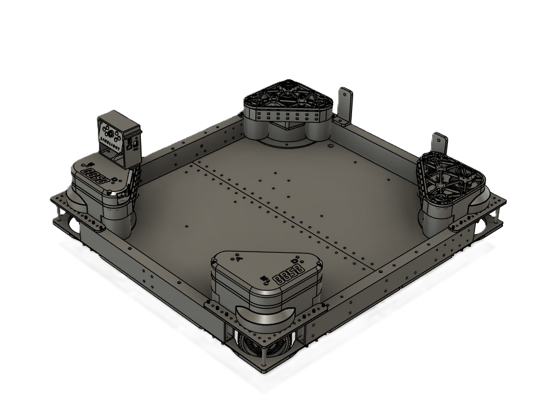

# Swerve Subsystem

The Swerve Subsystem is made to allow for full mobility around the field. The use of independent direction and angle motors gives Echidna the ability to have independant turning and drive capabilities, allowing Echidna drive throughout the field without the limitations of a regular tank drive.

## Coding

* Intial code from from [YAGSL](https://github.com/Yet-Another-Software-Suite/YAGSL/tree/main/examples/full_example).

```java
// Example instantiation within RobotContainer.java
private final SwerveSubsystem drive = new SwerveSubsystem();
```

### Tele-op control

Swerve subsytem is controled by the two joysticks on the drivers controller.

* Left joystick will control translational movement (forward/backwards/left/right) relative to the driver's point of view.
* Right joystick will control rotational movement of the robot

The joystick inputs are processed by a `SwerveInputStream` defined as below within `DriverControls.java`:

```java
CommandXboxController controller = new CommandXboxController(controllerPort);

/**
 * Maps Controller inputs to a SwerveInputStream for
 * field-oriented driving with alliance-relative
 * controls and a deadband
 */
SwerveInputStream driveInputStream = SwerveInputStream.of(
    drivetrain.getSwerveDrive(),
    () -> controller.getLeftY() * 1,
    () -> controller.getLeftX() * 1
)
.withControllerRotationAxis(() -> controller.getRightX() * -1)
.robotRelative(false)
.scaleTranslation(Constants.TRANSLATION_SCALE)
.scaleRotation(Constants.ROTATION_SCALE)
.deadband(Constants.DEADBAND);

drivetrain.setDefaultCommand(
    drivetrain.driveFieldOriented(driveInputStream).withName("Drive" + ".test")
);
```

### Desktop simulation

The project uses YAGSL's built-in MapleSim drivetrain simulation. From this project
directory, run `.\gradlew.bat simulateJava` to launch the robot with the WPILib
simulation GUI and simulated Driver Station. Connect a controller to the computer
as joystick 0, enable Teleop in the simulated Driver Station, and use the normal
driver controls to move the robot.

YAGSL advances the simulated drivetrain and publishes its field pose as part of
`updateOdometry()`, which the swerve subsystem calls from its periodic loop. The
WPILib field view is published at `/SmartDashboard/Field`. Elastic's existing
`Swerve` and `Field` views consume the same NetworkTables telemetry; in simulation
the robot publishes it locally through AdvantageKit's NT4 publisher.

#### 3D field with game elements

For a 3D view, open AdvantageScope (WPILib) and connect to the simulator
(**File → Connect to Simulator**). Add a **3D Field** tab, choose the 2026 *Rebuilt* field,
and drag these entries onto it:

* `NT:/AdvantageKit/RealOutputs/FieldSimulation/RobotPose` as a *Robot* (Pose2d)
* `NT:/AdvantageKit/RealOutputs/FieldSimulation/Fuel` as a *Game Piece* (Pose3d array)
* `NT:/AdvantageKit/RealOutputs/FieldSimulation/HeldFuel` as a second *Game Piece* (Pose3d array, type Fuel) for fuel inside the robot. If it is added but invisible, the robot model's solid hopper is probably hiding it: raise `SIM_HOPPER_FLOOR_Z` in `Constants.java` or make the robot model semi-transparent/ghosted to check placement.

The robot's `simulationPeriodic()` publishes both from the MapleSim arena.

To see the simulated Limelight, also add:

* `NT:/AdvantageKit/RealOutputs/FieldSimulation/LimelightPose` as a *Camera/Ghost* (Pose3d) to show the camera position and view
* `NT:/AdvantageKit/RealOutputs/FieldSimulation/VisibleTags` as an *AprilTag* (Pose3d array) to highlight the tags the camera currently sees

The simulated detection is approximate (field-of-view cone and range only, no occlusion), using the mounting from the Limelight settings in `SwerveSubsystem`. While at least one tag is visible, the odometry estimate is snapped to the simulator's true pose.

To have the camera follow the selected Driver Station and switch to a side view with **L3+R3**, add this to the 3D Field and select a fixed robot camera (use the dedicated `SimCamera` entry from the Echidna robot config) as the camera:

* `NT:/AdvantageKit/RealOutputs/FieldSimulation/CameraOverride` as a *Camera Override* (Pose3d)

AdvantageScope only applies Camera Override while a robot camera is selected, not with *Driver Station (Auto)*, so the robot publishes the station view itself. By default the camera sits where AdvantageScope's own Driver Station camera would (1.5 m behind the alliance wall, 62 in high, facing field center) for the alliance and station selected in the simulated Driver Station. Pressing L3+R3 moves it to a livestream-style side view; pressing it again returns to the station view. The geometry constants (`SIM_SIDE_CAMERA`, station spacing and so on) are in `SwerveSubsystem`. If station 1 and 3 appear swapped, flip the sign on `offset` in `getSimCameraPose()`. `SimCamera` has its own FOV in `advantagescope_assets/Robot_Echidna/config.json`, so changing the driver-view FOV no longer affects Limelight simulation.

### Autonomous control

Swerve is controlled in auto by using Path Planner. Path Planner is a program that uses algorithms to compute a safe, collision-free trajectory from a starting point to end target position while keeping in mind robot dimensions and field elements.

## Electrical

### Feedback

* CANcoders
* [NavX](https://docs.wpilib.org/en/stable/docs/software/hardware-apis/sensors/gyros-software.html#navx) used as gyro. Connected via SPI ([Serial Peripheral Interface](https://en.wikipedia.org/wiki/Serial_Peripheral_Interface)) as recommended by [Studica](https://pdocs.kauailabs.com/navx-mxp/guidance/selecting-an-interface/) for being highest-speed and lowest-latency.
* [Limelight](https://docs.limelightvision.io/en/latest/) for vision processing. Provides an estimation of the robot's pose.

### Interface types

* Each motor and encoder is connected to the robot via the CAN Bus.

Table: Swerve CAN IDs

| CAN ID          | Function                |
|-----------------|-------------------------|
| **Front Left**  |                         |
|1                |Front Left Encoder       |
|2                |Front Left Angle Motor   |
|3                |Front Left Drive Motor   |
| **Front Right** |                         |
|4                |Front Right Encoder      |
|5                |Front Right Angle Motor  |
|6                |Front Right Drive Motor  |
| **Back Left**   |                         |
|7                |Back Left Encoder        |
|8                |Back Left Angle Motor    |
|9                |Back Left Drive Motor    |
| **Back Right**  |                         |
|10               |Back Right Encoder       |
|11               |Back Right Angle Motor   |
|12               |Back Right Drive Motor   |

## Mechanical

Each of the 4 Swerve Modules are MK4i modules from [Swerve Drive Specialties](https://www.swervedrivespecialties.com/products/mk4i-swerve-module) in the L2 Configuration. These swerve modules have been reused from the 2025 FRC season.

### CAD Model




<!-- pagebreak -->
